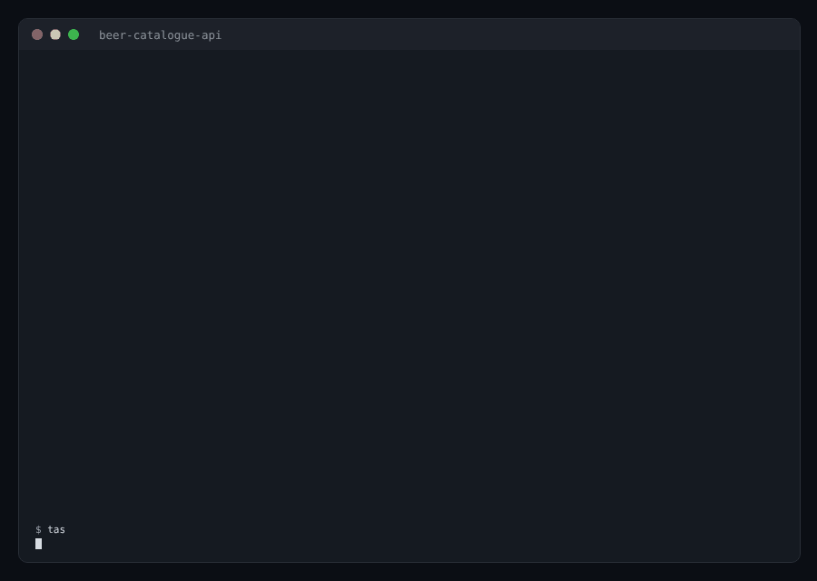
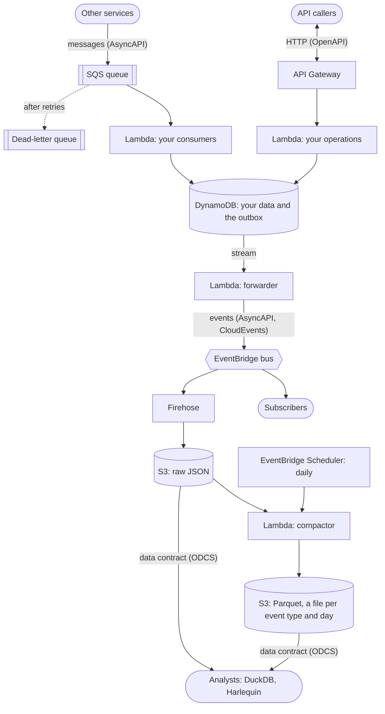
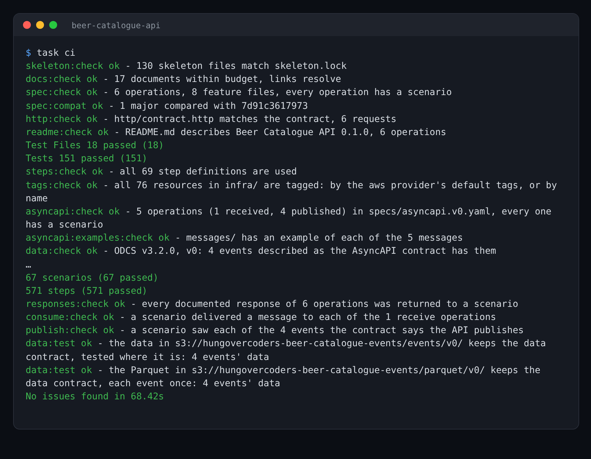

# template-aws-api

[](https://github.com/hungovercoders/template-aws-api/actions/workflows/template.yml)
[](LICENSE)
[](../../generate)

**Describe your API. Get it built, tested and deployable on AWS.**

[Start here](#start-here) · [Architecture](#the-architecture-you-get) · [What you get](#what-you-get) ·
[Why a template](#why-a-template-not-a-prompt) · [How it works](#how-it-works) · [See it working](#see-it-working) ·
[Tasks](#everyday-tasks) · [Layout](#where-things-are) · [Guides](#guides)

A template for AWS Lambda APIs where you write only what makes the API
yours: what it does, in plain-language scenarios, and what it looks like, in
a contract. Everything else is already here, and an AI agent fills in the
business logic until every check passes.

You write this:

```gherkin
@operation:create_beer
Scenario: Adding a beer to the catalogue
  When staff add the beer "Morning After", an ipa at 5.6% abv
  Then the beer is added
  And the response says where to fetch the new beer
```

The agent writes the logic: one small function per operation, and the glue
for your sentences. From the example, shortened:

```ts
export async function create_beer_v0({ body }: Context<"create_beer_v0">) {
  const beer = { id: randomUUID(), name: body.name.trim(), style: body.style, abv: oneDecimal(body.abv) };
  await putNewBeer(beer);
  return json(201, toBeer(beer), { location: `/v0/beers/${beer.id}` });
}
```

`task ci` then runs your scenarios against the real Lambda, on a local copy
of AWS, and says whether it is finished. Here it is running: a request, a
refusal, the event it published, and that event compacted to Parquet in S3
and queried there (real output, shortened).



## Start here

### 1. Set up your machine (once)

You need [mise](https://mise.jdx.dev), which installs every other tool - Node,
Task, Terraform, uv - at the versions in `mise.toml`, so your machine and CI
run the same ones. On macOS you also need Docker.

| | macOS | Linux (and Windows, in [WSL 2](https://learn.microsoft.com/windows/wsl/install)) |
| --- | --- | --- |
| Install mise | `brew install mise` | `curl https://mise.run \| sh` |
| Put it on your shell | `echo 'eval "$(mise activate zsh)"' >> ~/.zshrc` | `echo 'eval "$(~/.local/bin/mise activate bash)"' >> ~/.bashrc` |
| AWS Emulator, the local copy of AWS | Runs in Docker: install [Docker Desktop](https://www.docker.com/products/docker-desktop/), start it, and give it at least 4 GB of memory (Settings → Resources) | Nothing to install: the first run downloads and verifies it. It needs `gpg` and `dpkg-deb`, already there on Debian and Ubuntu |

Then open a new terminal, so the shell picks mise up. Check it with
`mise --version`, and on macOS `docker info`.

### 2. See the example running

Before building your own, run the finished example - the Beer Catalogue API:

```sh
git clone https://github.com/hungovercoders/template-aws-api.git && cd template-aws-api
git checkout example/implementation
mise trust && mise install
```

**Terminal 1** - start the API, and leave it running:

```sh
task dev
```

The first run takes a few minutes: it fetches AWS Emulator (on macOS, it
builds its Docker image), starts it, and applies `infra/` to it with
Terraform. Then it prints the API's URL and a token. `Ctrl-C` stops it and
throws the stack away; the next `task dev` starts clean.

**Terminal 2** - use it, in the same folder:

```sh
task http          # pick a request from http/contract.http and send it
task events:tail   # follow the events the API publishes
task data:query    # query the events kept in S3, with SQL
```

**Run every check** - what CI runs, about ten minutes:

```sh
task ci                       # with task dev stopped: both use port 9297
EMULATOR_PORT=9298 task ci    # or beside a running task dev
```

**macOS, Linux and CI** run the same tasks against the same emulator version.
The only difference is where the emulator runs:

| | macOS | Linux | CI (GitHub Actions) |
| --- | --- | --- | --- |
| AWS Emulator | In Docker, a fresh container each run (ARM on Apple silicon) | Native package, in `.tools/` | Native package, x86 |
| First run | Builds the emulator's image | Downloads it and checks AWS's signature | The same, every run |

### 3. Build your own

1. **Create your repository.** Click *Use this template* on GitHub, leave
   "Include all branches" unticked, clone it, then run `mise trust && mise install`.
2. **Write the spec.** In [Claude Code](https://claude.com/claude-code), the
   AI agent that works with you here, run `/write-spec`. It asks what the API
   should do, drafts the scenarios and contracts with you, and checks them.
   Prefer to write it yourself? [By hand](docs/spec.md#writing-it-by-hand).
3. **Make it yours.** Run `task adopt` once. It removes what is only about
   the template and replaces this README with one that describes your API.
4. **Have it built.** Run `/implement-api`. The agent generates what follows
   from the spec, writes the logic, and works until `task ci` is green. It
   may not edit your spec, weaken a check or rebuild the template.
5. **Deploy when you are ready.** `task deploy NAME=my-api`, or let CI deploy
   `main` ([Deploying](docs/deploying.md#deploy)). Nothing deploys until you
   opt in.

## The architecture you get

One service, every way in and out of it described by a contract:



| Interface | Direction | Contract | Optional |
| --- | --- | --- | --- |
| HTTP API | in and out | `specs/openapi.v<N>.yaml` | no |
| Messages from a queue | in | `specs/asyncapi.v<N>.yaml`, `receive` | yes |
| Events on a bus | out | `specs/asyncapi.v<N>.yaml`, `send` | yes |
| Events as data in S3 | out | `specs/datacontract.v<N>.yaml` | yes |

Each part brings its Terraform, alarms, logs and tags. An API that does not
need an optional part removes it, and can bring it back later:
`task component:list`.

## What you get

**An HTTP API that holds to its contract**

- Routing, request validation and standard error responses (RFC 9457).
- Sign-in, from the contract's `security`.
- Types, the route table and a stub for every operation, generated.
- A mock of the contract your consumers can call before anything is built.

**Messages in, events out - only if you need them**

- A queue with retries and duplicate handling: one function per message.
- Events published with the change they describe: `outbox(event)` in a write.
- Those events kept in S3 and compacted daily to typed Parquet, both tested
  against a data contract, with DuckDB and Harlequin to query them.

**Tests that mean something**

- Your scenarios run against the built Lambda, through the stack your own
  Terraform created on [AWS Emulator](https://github.com/aws/aws-emulator).
  Nothing is mocked.
- Every response is checked against the contract, and the API is fuzzed.

**Ready for production**

- Terraform for the whole stack, with tags on every resource.
- Alarms, each with a runbook entry, and structured logs.
- CI on GitHub Actions, and deployment without stored keys.

## Why a template, not a prompt

Every API needs the same router, test harness, pipeline and Terraform. That
should be built once, not regenerated slightly differently by AI each time.

- **Known problems stay solved.** Asking an agent to work them out again
  costs tokens and review time on every project. AI works only on what is
  new: your business logic.
- **The spec is the prompt and the test.** The files that tell the agent what
  to build are run against what it built, so "done" has one answer.
- **Generate before you write.** Anything a command can derive from the spec
  comes from that command: identical every time, and it cannot drift.
- **Every API looks the same.** Seen one, seen them all.

If you catch yourself asking AI for a router, a test harness or a pipeline
here, stop: it exists. If something every API needs is missing, add it to
the template once, not to one API.

## How it works

```
specs/openapi.v<N>.yaml   ─┬─► request validation inside the Lambda
 (a file per live major)   ├─► types, the route table and a stub for every operation
                           ├─► API Gateway routes under /v<N> (Terraform reads them)
                           ├─► response validation on every call the features make
                           └─► generated fuzz requests (schemathesis)

specs/asyncapi.v<N>.yaml  ─┬─► every message and event validated as a CloudEvent
 (messages, events)        └─► a typed stub per message, a typed function per event

specs/datacontract.v<N>.yaml ─┬─► per major: a stream, its retention and alarms (Terraform reads it)
 (events as data)             ├─► a daily compaction to Parquet, typed by the contract
                              └─► a test of what landed, raw and in Parquet

specs/features/*.feature ──► cucumber, strict, against the built Lambda
   (the behaviour)           on infra/ applied to AWS Emulator
```

| You bring | The template has | The agent writes |
| --- | --- | --- |
| `specs/openapi.v<N>.yaml`, `specs/features/` | The Lambda, router, validation, harness, CI, Terraform | `src/operations/`, `steps/`, `src/domain/`, `src/store/` |
| `specs/asyncapi.v<N>.yaml`, if it has messages or events | The queue, the outbox, the event bus | `src/consumers/`, and `outbox(event)` in a write |
| `specs/datacontract.v<N>.yaml`: owner, retention, sensitivity | The bucket, delivery, the daily Parquet compaction, the data test | |
| Who owns it: `domain` and `team` | Tags and a resource group | |

## See it working

The Beer Catalogue API is built on this template, one branch per step:

| Branch | What it is | `task ci` |
| --- | --- | --- |
| [`main`](../../tree/main) | The template, ready to use | Red - no spec yet |
| [`example/spec`](../../tree/example/spec) | The template and a complete spec | Red - not implemented yet |
| [`example/implementation`](../../tree/example/implementation) | That spec, delivered with `/implement-api` | Green |

Compare them:
[`main...example/spec`](../../compare/main...example/spec) is what a spec
looks like, and
[`example/spec...example/implementation`](../../compare/example/spec...example/implementation)
is what implementing one adds.

`task ci` on `example/implementation` (selected lines):



> **CI on `main` is red on purpose.** There is no spec to build yet, so
> `task ci` fails until you add one. Changes to the template itself are
> proved by a separate check, `template`, which lays the example over them.

## Everyday tasks

Every command is a task. `task` lists them all; these are the ones you
start with. Only `task dev` keeps its terminal; the tasks that need the stack,
such as `task features` and `task ci`, start and stop an emulator of their own.

| Task | What it does |
| --- | --- |
| `task ci` | Every check, in order. The definition of done; what CI runs |
| `task check` | The fast checks for the stage you have reached; `task hooks:install` runs it before every push |
| `task dev` | Your API on AWS Emulator, kept running; prints its URL and a token |
| `task http` | Send requests to the mock, the local stack or a deployed API |
| `task mock` | Serve a mock of the contract - no implementation needed |
| `task scaffold` | Write what follows from the spec: a stub per operation, a pending step per sentence |
| `task features` | Run the scenarios against the built Lambda |
| `task queue:send`, `task events:tail`, `task data:query` | Send a message, follow published events, query the events in S3 |
| `task deploy` | Apply the stack to AWS (opt-in) |

## Where things are

```
specs/                  the contracts and features/          ← you write
src/operations/         one file per operation               ← written from the spec
src/consumers/          one file per message received        ← written from the spec
src/domain/, src/store/ your rules and data access           ← written from the spec
steps/                  glue for your feature sentences      ← written from the spec
src/lib/, src/handler.ts  router, validation, DynamoDB, queue, outbox: the template's
infra/                  Terraform; tags.auto.tfvars.json     ← you say who owns it
local/                  runs the stack on AWS Emulator; the queue, event and data tasks
docs/                   one guide per reader; runbook.md for alarms
messages/, http/        examples of every message; requests to explore by hand
rules/, .spectral.yaml  contract standards: shared, and this API's ← you add
.claude/skills/         write-spec, implement-api, and AWS's own skills (skills.json)
scripts/, tools/        the generators and checks
AGENTS.md               instructions for coding agents
CONTRIBUTING.md         how the API is changed: spec first, then implementation
skeleton.lock, components.json  what the template is, and its optional parts
```

## Guides

| Guide | Read it when |
| --- | --- |
| [The spec](docs/spec.md) | Writing or changing the contract and feature files; standards; versioning; the mock |
| [Testing](docs/testing.md) | A check fails, or you want to run or explore the API locally |
| [Deploying](docs/deploying.md) | Putting an API on AWS; sign-in, CORS and CI deployment |
| [Runbook](docs/runbook.md) | An alarm has fired |
<!-- component:data:start -->
| [Events as data](docs/data.md) | The events are kept in S3: their data contract, querying them, and their alarms |
<!-- component:data:end -->

Changing an API built on this, or the template itself:
[CONTRIBUTING.md](CONTRIBUTING.md). Reporting a vulnerability:
[SECURITY.md](SECURITY.md). Change the copyright line in `LICENSE` if the
code is not MIT or not yours to license that way.
